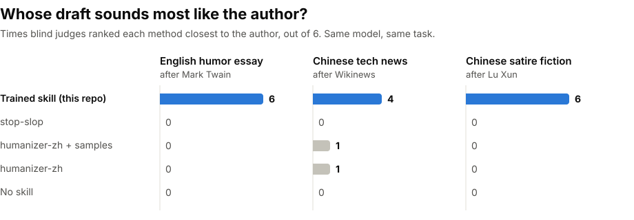

<div align="center">

# Writing Skill Trainer

**De-AI skills make a draft sound less like a machine.<br>This one makes it sound like you.**

**English** · [简体中文](README.zh-CN.md)

</div>

<picture>
  <source media="(prefers-color-scheme: dark)" srcset="assets/voice-first-en-dark.svg">
  
</picture>

Give it three or more things you wrote. It works out how you make a point, writes that down as a reusable skill, and checks the result with blind judges.

## Read it yourself

One task, one model, one fact pack: *a 51-year-old buys a $640 smart standing desk; it rises to 48 inches and will not come down for three days.* Write it as a humorous essay. The only thing that changes below is the skill. Each row is the same moment in the story.

<table>
<tr>
<th width="33%">No skill</th>
<th width="33%"><a href="https://github.com/hardikpandya/stop-slop">stop-slop</a> (19k★)</th>
<th width="33%">Trained on 3 Mark Twain essays</th>
</tr>
<tr><td colspan="3"><b>The desk will not come down</b></td></tr>
<tr>
<td valign="top">

It rose to its full height of 48 inches, with the quiet confidence of a thing that has never been told no, and there it stayed. It did not come down that day. It did not come down the next. It did not come down on the third, either, and by then I had stopped calling it a desk and started calling it a monument.

</td>
<td valign="top">

On the first morning I pressed the button and the desk rose to its full height of 48 inches. There it stayed. I pressed the button again. I pressed the app. I pressed the desk itself, with my palm, the way you press a horse. For three days it held at 48 inches like a flagpole with nothing to fly.

</td>
<td valign="top">

Then I asked it to come down, and it declined, and it went on declining for three days.

I want to be fair to the desk. It had been asked to stand, and it stood. My own doctor has never been able to say as much for his patients. If anyone in the household had a record of perfect compliance, it was the desk, and I felt a certain pride in it, as one does in a nephew who has done well in an unrelated field.

</td>
</tr>
<tr><td colspan="3"><b>The help line says “restart the furniture”</b></td></tr>
<tr>
<td valign="top">

I called the company's help line. A pleasant voice listened to my situation and advised me, with perfect seriousness, to "restart the furniture." I have thought about that sentence many times. Nobody had ever suggested to me that furniture could be restarted.

</td>
<td valign="top">

I have restarted computers, routers and a thermostat, but nobody had ever asked me to restart a piece of furniture. I stood on my chair in the quiet and tried to work out which part of a desk is its brain. I patted the top. It gave me nothing.

</td>
<td valign="top">

I have been told many things by professionals, but I had not before been asked to restart anything I could sit on. I thanked the voice. I did not restart the furniture, as I could not think how one begins, or what the furniture would say about it afterward.

</td>
</tr>
<tr><td colspan="3"><b>The neighbor pulls the plug</b></td></tr>
<tr>
<td valign="top">

The desk came down. It made a small sound as it descended, a kind of mechanical sigh, as if it too had been waiting for someone sensible to arrive.

</td>
<td valign="top">

She did not ask for the password. She gave me the look a teacher gives a student who has skipped the instructions, and she went home.

</td>
<td valign="top">

The desk came down at once. It had the manner of a child who has been spoken to by someone with experience. I do not say that the app, the account and the fourteen characters were of no use. I say only that none of them was Mrs. Abernathy.

</td>
</tr>
</table>

Here is how Twain described his own method, in an essay none of the three writers saw:

> The humorous story is told gravely; the teller does his best to conceal the fact that he even dimly suspects that there is anything funny about it.

All six blind judgments put the right-hand draft closest to him, and all six put stop-slop last. stop-slop removed the stock phrases. It had no way to know whose voice to aim for.

### The same drafts, checked against the facts

The task said: add no facts beyond the material.

<table>
<tr>
<th width="50%">stop-slop</th>
<th width="50%">Trained skill</th>
</tr>
<tr>
<td valign="top">

The account wants a password of at least 14 characters. **I have a mortgage, a car and a drawer of tax returns**, and none of them ever asked me for 14 characters. **I typed my street, then my first pet, then a long sentence about my feelings toward the app.**

</td>
<td valign="top">

The app requires an account, and the account requires a password of at least fourteen characters. I chose one with care. I mention the password so that no one will say I entered into this lightly.

</td>
</tr>
</table>

Bold text is not in the fact pack. The trained draft was not spotless either: judges flagged it for placing the help-line call "on the third day". It added the least of the five.

The two other methods in the chart, humanizer-zh with and without author samples, changed very little: their rewrites are 86–100% identical to the draft they started from. It kept the facts, as it promises to. It does not move a draft toward an author.

Everything is in the repo: [all 30 drafts, the judges' verdicts, prompts and scripts](marketing/writing-skill-trainer/evals/vs-deai/).

## How it works

1. **Scope.** You confirm the samples are yours to use, what the skill will write, and which samples are held back.
2. **Evidence.** Every rule it proposes is tied to passages in your samples.
3. **Draft.** It writes a small skill: `SKILL.md` plus a style profile.
4. **Test.** Each test task is written at least twice. A script checks length, new numbers and overlap with your samples. Then blind judges compare drafts with the labels swapped.
5. **Improve.** One change per round, kept only if it does not lose overall.
6. **Calibrate.** You read two or three anonymous pairs, to check the judges agree with you.

A full run starts about 17–22 sub-agents.

## Install

Copy the whole skill folder, not only `SKILL.md`.

```bash
git clone --depth 1 https://github.com/seasonsolt/writing-skill-trainer.git

# Claude Code
mkdir -p ~/.claude/skills
cp -R writing-skill-trainer/skills/writing-skill-trainer ~/.claude/skills/

# Codex
mkdir -p ~/.agents/skills
cp -R writing-skill-trainer/skills/writing-skill-trainer ~/.agents/skills/
```

## Use

```text
Use writing-skill-trainer to train a Writing Skill from my articles in ./posts, and validate it with blind evaluation.
```

Bring at least three pieces you wrote or have clear permission to use, and say what the skill should write: the kind of piece, the reader, the length. The skill's own documentation is in Chinese; it trains skills in the language of your samples.

## Repository

```text
skills/writing-skill-trainer/     the skill: copy this folder to install
marketing/writing-skill-trainer/  both evaluations, with every draft and verdict
assets/                           README charts (built by evals/vs-deai/chart.py)
scripts/check.py                  repository checks: metadata, links, JSON, tests
```

```bash
python3 -m pip install pyyaml && python3 scripts/check.py   # Python 3.10+
```

## License

Code and documentation: [Apache-2.0](LICENSE). The sample texts keep their own terms; see [`THIRD_PARTY_NOTICES.md`](THIRD_PARTY_NOTICES.md). Contributing: [`CONTRIBUTING.md`](CONTRIBUTING.md). Security: [`SECURITY.md`](SECURITY.md).
