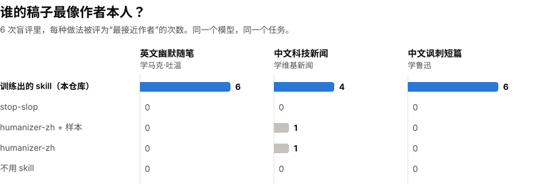

<div align="center">

# Writing Skill Trainer

**去 AI 味的 skill 让稿子不像机器写的。<br>这个 skill 让稿子像你写的。**

[English](README.md) · **简体中文**

</div>

<picture>
  <source media="(prefers-color-scheme: dark)" srcset="assets/voice-first-zh-dark.svg">
  
</picture>

给它三篇以上你自己写的文章。它找出你是怎么下判断、怎么用证据的，写成一个可以反复使用的 skill，再请匿名评审来验证。

## 直接读稿子

同一个任务、同一个模型、同一份素材：*县城政务大厅上线“静音意见箱”，扫码后只能选“非常满意、满意、已了解”。修鞋老人不会扫码，拿来一封手写信。下班前，临时工周河在系统里替老人选了“已了解”，把信夹进自己的考勤本。* 要求写成一篇冷峻克制的讽刺短篇。下面三份稿子只有用的 skill 不同，每一行是同一个时刻。

<table>
<tr>
<th width="33%">不用 skill</th>
<th width="33%"><a href="https://github.com/hardikpandya/stop-slop">stop-slop</a>（1.9 万星）</th>
<th width="33%">用 3 篇鲁迅小说训练出的 skill</th>
</tr>
<tr><td colspan="3"><b>老人来了</b></td></tr>
<tr>
<td valign="top">

第三十天的下午，大厅门口来了一位修鞋的老人。老人姓什么没人知道，大家只认得他的摊子，在大厅斜对面的梧桐树下，一块木板，一盏小灯。他站在屏幕前看了很久。他不会扫那个二维码，他的手机只能接电话。

</td>
<td valign="top">

第三十天，一位修鞋的老人来到大厅。他七十多岁，手上有洗不掉的黑胶，怀里揣着一封信，信纸对折了四次。他不会扫码，也不肯让别人替他扫。

</td>
<td valign="top">

修鞋的老人那天坐在最靠边的一张上，膝盖上放着一块帆布，帆布上是一双没来得及放下的旧鞋。他的手很黑，指缝里嵌着鞋油，先在裤腿上蹭了两下，才把信封递出来。信封上的字是圆珠笔写的，一笔一笔，压得很重，纸背都鼓起来了。

</td>
</tr>
<tr><td colspan="3"><b>下班前</b></td></tr>
<tr>
<td valign="top">

下班之前，周河一个人留在大厅里。他用自己的账号登录后台，找到老人那条空白的记录，选了“已了解”。他认为这是三个选项里唯一诚实的一个：系统确实已经了解了，只是了解的不是信的内容。

</td>
<td valign="top">

下班前，周河打开后台，以老人的名义选了“已了解”。屏幕弹出那行字：感谢您的宝贵意见。他看了十秒，等它自己消失。

</td>
<td valign="top">

下班前，周河登录了系统。后台的界面很简单，他选了老人的那一条，光标在三个选项上停了一下。非常满意，满意，已了解。他选了已了解。点确认的时候，鼠标发出一声很轻的响。

</td>
</tr>
<tr><td colspan="3"><b>结尾</b></td></tr>
<tr>
<td valign="top">

周河站在人群后面，没有鼓掌。大厅里很安静，安静得像一个设计得很成功的产品。

</td>
<td valign="top">

老人没有来。台阶下那块地方空着，地上留着一圈鞋油的印子，保洁员下午拖掉了。

</td>
<td valign="top">

周河的背包挂在椅背上。考勤本在里面，他没有拿出来过。他好像也不确定，那封信该算在哪一天里。

</td>
</tr>
</table>

鲁迅在《药》里是这样写的，三个写手都没看过这一篇：

> 街上黑沉沉的一无所有，只有一条灰白的路，看得分明。灯光照着他的两脚，一前一后的走。有时也遇到几只狗，可是一只也没有叫。

左边那份每到要紧处就替读者把讽刺讲明白：“唯一诚实的一个”“像一个设计得很成功的产品”。右边那份只写手、信封和鼠标的响声，到结尾也没有下判断。6 次盲评都把它评为最接近作者，stop-slop 6 次都排第二。

### 同样的做法，再看事实

素材没有说信里写了什么。

<table>
<tr>
<th width="50%">stop-slop</th>
<th width="50%">训练出的 skill</th>
</tr>
<tr>
<td valign="top">

周河拆开信。**信里写的是鞋摊的位置。老人在大厅外的台阶下摆了十一年摊，上个月有人通知他，那里要建一个“文明岗亭”，请他搬走，没说搬去哪里。**

</td>
<td valign="top">

周河说好。他把信收下来，放在桌角，压在鼠标垫下面，鼠标垫的一角翘着，信的边也跟着翘起来一点。

</td>
</tr>
</table>

加粗的内容素材里没有：stop-slop 替老人把信写了出来。训练后的稿件里，那封信从头到尾没有被拆开。这个场景里，stop-slop 的两份稿件都被多数评审判为改动或补造了事实，训练后的两份都没有。

图里另外两种做法是 humanizer-zh（给作者样本和不给）。它改得很少：改写稿和原稿有 86%—100% 相同。它按自己的承诺守住了事实，但不会把稿子往某个作者的写法上改。

全部材料都在仓库里：[30 份稿件、评审结论、提示词和脚本](marketing/writing-skill-trainer/evals/vs-deai/)。

## 它怎么做

1. **定范围。** 你确认样本可以用、这个 skill 以后写什么、哪几篇留着不参与训练。
2. **取证。** 它提出的每条写法规则，都要对应到你样本里的段落。
3. **起草。** 写出一个小的 skill：`SKILL.md` 加一份风格档案。
4. **测试。** 每个测试任务至少写两份。脚本先查字数、素材外的数字、和样本的重合，再请匿名评审比较，并交换顺序评两次。
5. **改进。** 每轮只改一处，合计不输才保留。
6. **校准。** 你匿名读两三对稿件，确认评审的口味和你一致。

完整训练一次大约启动 17—22 个子 agent。

## 安装

复制整个 skill 目录，不要只复制 `SKILL.md`。

```bash
git clone --depth 1 https://github.com/seasonsolt/writing-skill-trainer.git

# Claude Code
mkdir -p ~/.claude/skills
cp -R writing-skill-trainer/skills/writing-skill-trainer ~/.claude/skills/

# Codex
mkdir -p ~/.agents/skills
cp -R writing-skill-trainer/skills/writing-skill-trainer ~/.agents/skills/
```

## 使用

```text
用 writing-skill-trainer，从 ./posts 里我写的文章训练一个 Writing Skill，并做盲评验证。
```

准备至少三篇你自己写的、或明确获得授权的文章，并说明这个 skill 以后要写什么：题型、读者、长度。

## 仓库结构

```text
skills/writing-skill-trainer/     skill 本体：安装时复制这个目录
marketing/writing-skill-trainer/  两次评测，含全部稿件和评审结论
assets/                           首页的图（由 evals/vs-deai/chart.py 生成）
scripts/check.py                  仓库检查：元数据、链接、JSON、测试
```

```bash
python3 -m pip install pyyaml && python3 scripts/check.py   # Python 3.10+
```

## 许可证

代码和文档：[Apache-2.0](LICENSE)。评测用的样本文本各自保留原有条款，见 [`THIRD_PARTY_NOTICES.md`](THIRD_PARTY_NOTICES.md)。参与方式：[`CONTRIBUTING.md`](CONTRIBUTING.md)。安全问题：[`SECURITY.md`](SECURITY.md)。
